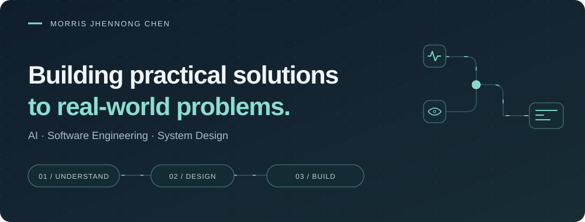

<picture>
  <source media="(max-width: 600px)" srcset="assets/profile-banner-mobile.svg">
  
</picture>

  <a href="#selected-work">Selected work</a> &nbsp; / &nbsp;
  <a href="#toolkit">Capabilities</a> &nbsp; / &nbsp;
  <a href="https://www.linkedin.com/in/morris-jhennong-chen-5a05a5222/">Let's connect</a>

**Hi, I'm Morris.** I build software around practical problems—from reviewing clinical recordings to connecting gaze and language signals in a reading interface. My work spans **AI integration, backend development, and system design**.

I enjoy understanding how people work, choosing a useful approach, and connecting the pieces into a working system.

##  How I approach a problem

| Understand | Design | Build |
| :--- | :--- | :--- |
| Start with the workflow, the people, and the constraints. | Choose the methods and shape how the pieces fit together. | Connect models, services, and interfaces; check how they behave. |

##  Selected work

###  Clinical speech transcription & review

**Make recorded conversations easier to review.**

A local-first application bringing speech recognition, speaker-role labels, and timestamps into one review workflow for adult–child clinical recordings.

- Listen to the source audio, correct transcripts, and re-transcribe selected segments.
- Review recognition candidates and explicitly accept changes before saving.

Inside the build

The system connects local speech-processing services to a web interface, keeping transcript edits tied to source audio. Model integration and the review workflow are developed together, so people can inspect and correct the output.

**Focus:** speech processing · model integration · human review

---

###  [LexiGaze — multimodal reading analysis](https://github.com/momonong/lexigaze)

**Connect where we look with what we're reading.**

A platform that brings webcam gaze tracking and language-model features into a shared reading interface.

- Align gaze coordinates with words on screen and combine gaze and text features.
- Explore gaze-to-word decoding and calibration with offline evaluation.

Inside the build

The platform integrates gaze estimation, text analysis, and a Flask reading interface. Word positions provide a shared reference for gaze and language features; offline experiments explore decoding and calibration alongside the application.

**Focus:** computer vision · natural language processing · system integration

[Explore LexiGaze →](https://github.com/momonong/lexigaze)

##  What I bring to a project

**AI systems & retrieval** 
LLMs, RAG / GraphRAG, knowledge graphs, and AI agents—connecting information, models, and tools to support a specific workflow.

**End-to-end engineering** 
System design, backend services, model integration, and full-stack development—from data processing to interfaces people can use and review.

**Technical leadership & collaboration** 
Requirements analysis, technical project coordination, and mentoring—working with stakeholders and developers to turn needs into implementation priorities.

Technologies I've used

| Area | Technologies |
| :--- | :--- |
| AI & retrieval | Python · PyTorch · Neo4j · FAISS |
| Applications & data | React · FastAPI · Flask · PostgreSQL · MySQL |
| Infrastructure & development | Microsoft Azure · Docker · Linux · Git |

##  Let's compare notes

Working on an interesting problem? I'd enjoy hearing how you're approaching it—especially where **AI, software, and real workflows** meet.

[Connect on LinkedIn →](https://www.linkedin.com/in/morris-jhennong-chen-5a05a5222/)
